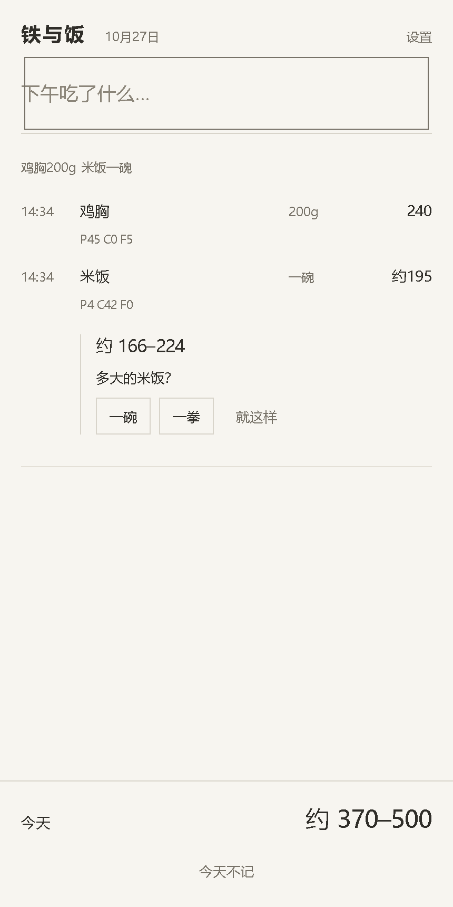

# 铁与饭

一句话记下你吃了什么，立刻知道大概多少热量。中文口语优先。

不追踪、不推送、不排名、不问你今天为什么没记。

```
$ meal "鸡胸200g 米饭一碗"
12:40  鸡胸         200g        240 P45 C0  F5
12:40  米饭         一碗      约195 P4  C42 F0
──────────────────────────────────
今天                     约 370–500
```



## 跑起来（v0 未发布 npm，用源码方式）

    git clone https://github.com/Fan-zhaolin/tiefan.git
    cd tiefan
    pnpm install && pnpm build

    # CLI
    node packages/cli/dist/index.js "鸡胸200g 米饭一碗"

    # Web（单文件，21KB）
    直接打开 packages/web/dist/index.html
    或把它丢到任意静态托管，手机浏览器打开 → 添加到主屏幕

## 它不做什么

- 不算达成率，不画进度环，不给红绿
- 不推送、不提醒、不做连续打卡
- 不把训练消耗折成热量加回来
- 不上传你的数据

## 数据

`packages/data/dishes/` 一个菜一个 YAML 文件，可读、可 diff、可 PR。
只用有明确授权的数据源（TFDA / USDA / 包装标签 / 人工配方），见 `docs/01-数据模型.md`。

## 状态

v0 开发中。规格见 `docs/`，任务见 `prompts/`。

当前完成 T6 单文件 Web 与 T5 CLI：9 个食物文件、6 个单位、10 个做法模板。验收保留原有5条并加入文档30条，可执行用例正常运行，缺数据用例显式跳过。

开发环境：Node.js 24.11 及以上，pnpm 11.7.0。

```bash
pnpm install
pnpm lint
pnpm test
pnpm validate
pnpm build
```

鸡胸、鸡蛋采用已核实的 USDA 记录，链接与原始精度写在 YAML 注释中。
米饭、牛奶、燕麦、牛肉、虾、番茄采用人工核对后录入的 USDA 记录，FDC 编号保留在 note 中。
番茄炒蛋尚未核实营养值，以 `kcal: null` 和「待录入」标记，不作为可计算数据。

`pnpm validate` 检查营养、结构、来源、物理上界和 skip 理由；`pnpm test` 按验收原始 expect 检查完整输出，并打印通过 / 跳过 / 失败数。
所有规则只在 `packages/data/src/rules.ts` 实现，CLI、测试和构建共用 `checkAll`，脚本不再单独修正校验结论。
`checkDish` 检查单菜，`checkAll` 汇总全库与语料；二者均为不做 IO 的纯函数。运行时与数据校验的物理上界共用 core 的 bounds 模块。
校验时由加载器把验收语料注入 `DataSet.acceptance`，缺少语料会报告规则 11 失败；构建的营养数据仍只有 dishes / units / methods。
`pnpm --filter @meal/data typecheck` 检查数据包及构建脚本类型；脚本由 Node.js 原生运行 TypeScript，不需要 tsx。
构建从 YAML 生成 `packages/data/dist/data.json`、类型及 `index.ts`，不手改 dist。
core 的 `parseMeal` 现返回 `MealResult`，缺数据保留 null，不从宏量、纤维或做法模板推算热量。任一条目未解析时，整餐五个合计字段全为 null。

构建后的命令入口是 `packages/cli/dist/index.js`（包内命令名 `meal`）：

```bash
pnpm cli "鸡胸200g 米饭一碗"
node packages/cli/dist/index.js --dry "鸡胸200g"
node packages/cli/dist/index.js --json "鸡胸200g"
node packages/cli/dist/index.js today
node packages/cli/dist/index.js export
```

无参数进入逐行输入，空行退出。默认记录到 `~/.meal/YYYY-MM-DD.jsonl`，可用 `MEAL_HOME` 覆盖；每行只含 `t/raw`，是原始输入日志。要算数先跑 `meal today`，按当前食物库重算，不从 JSONL 数字取统计。`--dry` 不写记录，`--json` 输出完整 `MealResult`。未识别项存在时显示「合计不可用：有 N 项没认出」。

`pnpm build` 后可直接打开 `packages/web/dist/index.html`，全部 JS、CSS、数据与 core 代码在同一文件，不请求外部资源。首屏是输入与时间线，记录留在本地 `localStorage`；顶部设置内可导出备份。「今天不记」只失焦，不产生任何记录或提示。Web 与 CLI 共用解析、合计和数值文案。测试会先构建实际 CLI / Web 产物，没有新增依赖。

补录顺序和每条跳过理由见 [T4 缺数据清单](docs/T4-缺数据清单.md)。

## License

代码 AGPL-3.0 · 数据 ODbL 1.0 · 规格 CC-BY-SA 4.0

